## AK与SK

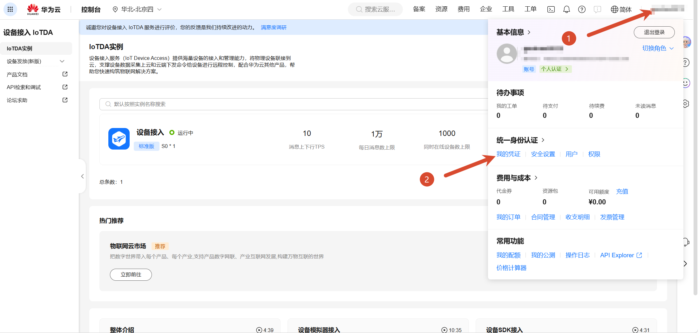

点击左侧访问密钥

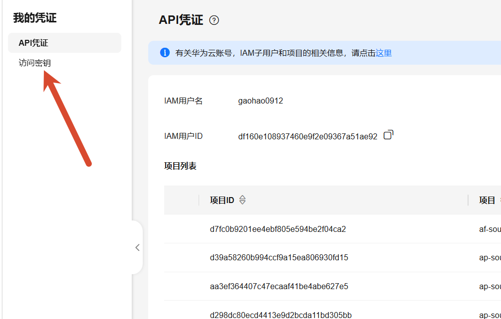

新增访问密钥-勾选协议-下一步

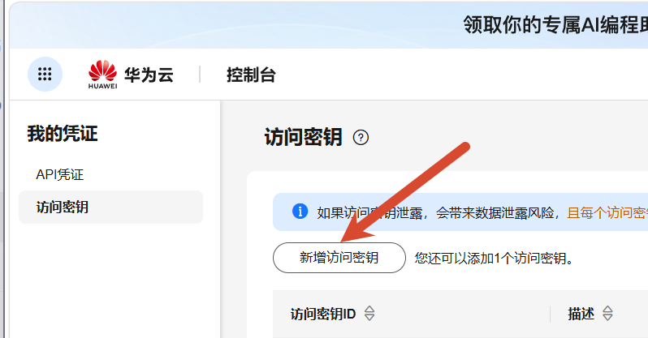

编写描述后确认-通过验证后下载AKSK文件就能看到

注意：AKSK文件只能下载一次，丢失后无法再次查看

## 项目ID与区域

我的凭证页面可以查看

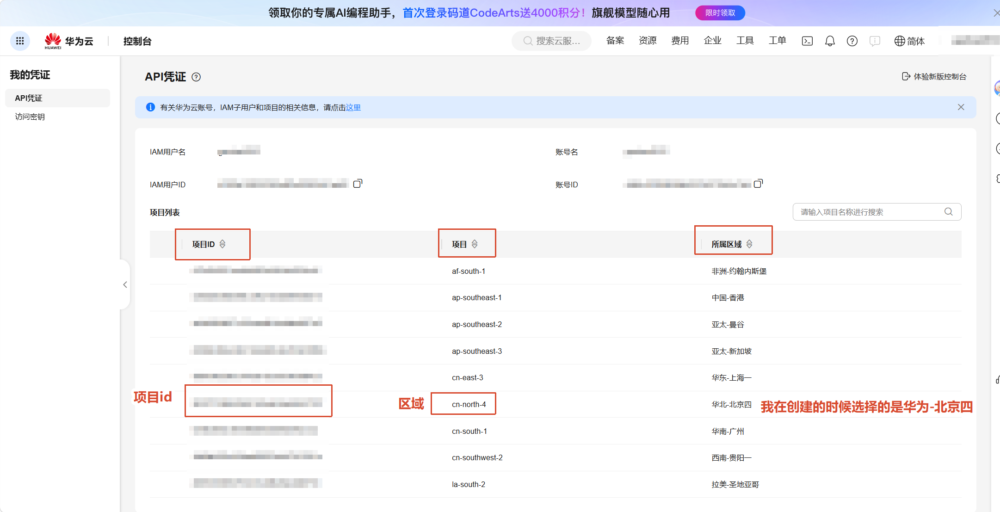

## 物联网平台应用侧接入地址

https://console.huaweicloud.com/iotdm/  （需要先登录）

点击设备接入

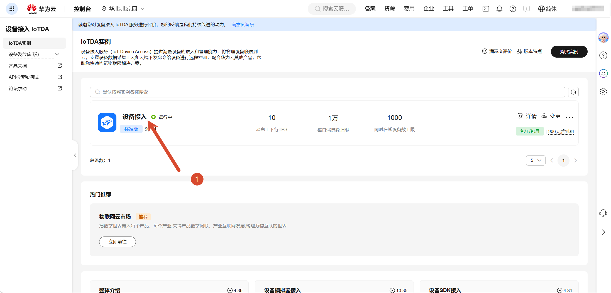

点击接入信息

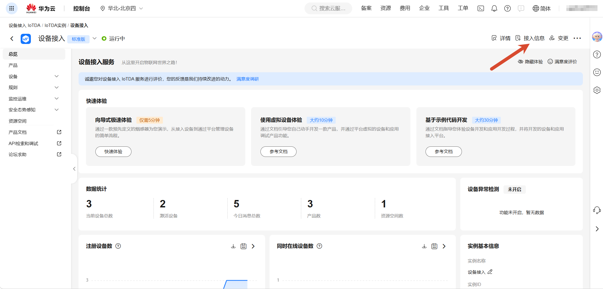

选择应用接入中的HTTPS（443）

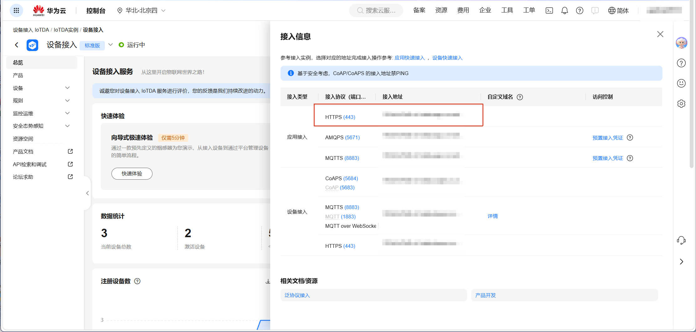

## 默认设备 ID

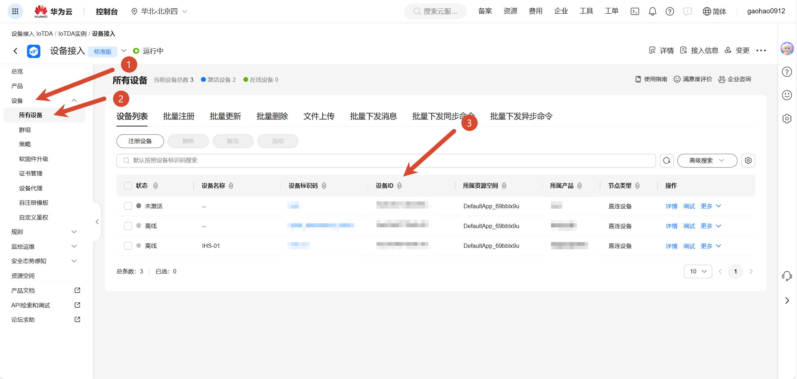

## 服务 ID

右击列表详情，箭头所指的就是服务id

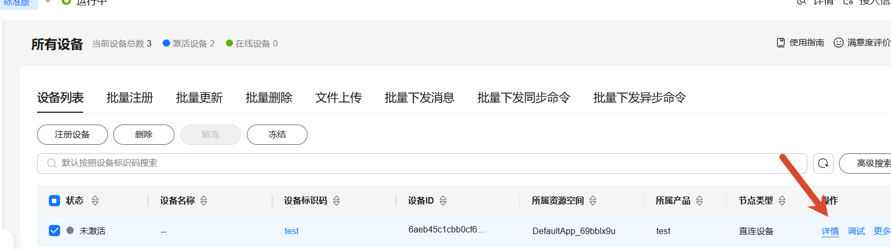

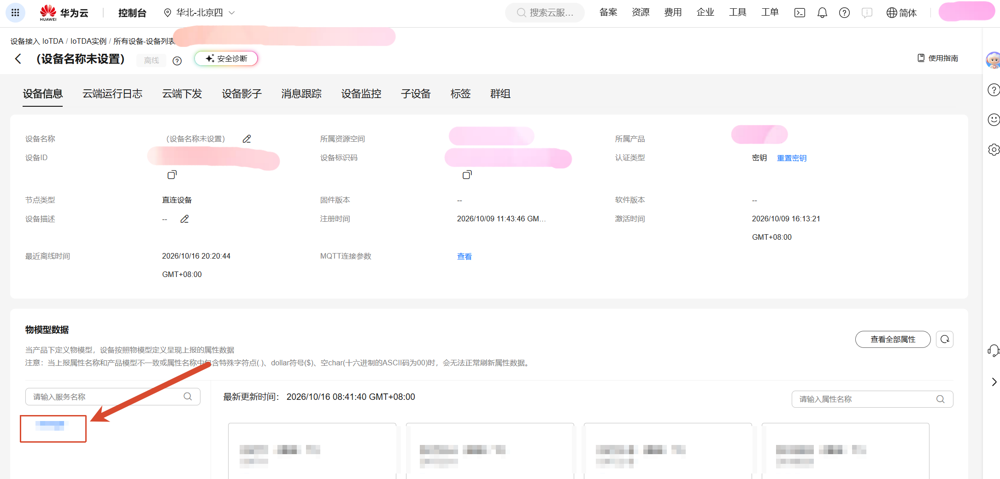

## 产品 ID（可选）

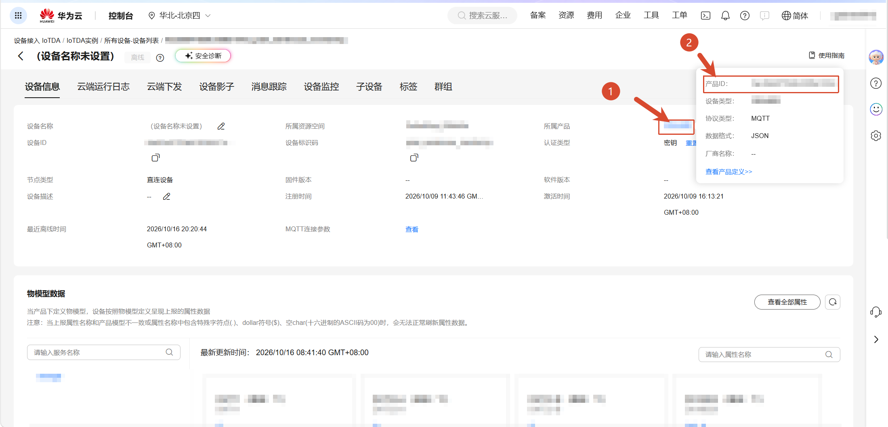